<p align="center">
  
</p>


# 趣玩星球 FunPlanet (Flutter项目)

原创作者：黄恒鑫

面向潮玩爱好者的 Flutter 移动电商 App，含商城购物、会员体系、AI 导购「小豆」、AI 绘画、AI 社区与在线客服。配套 Node.js 后端、React 管理后台与 PostgreSQL 数据库，已完成 Android Release 打包与云服务器部署。

当前版本要点：全店 **305 件原创商品**（8 大原创系列、角色与世界观均为虚构自创）；小豆已升级为能真正办事的 **AI 导购 Agent**——理解需求后自己查数据、比价、看口碑，亮出三张牌供用户挑选，并能一路代办到下单待付款；配套游戏式新手引导、聚合消息中心与统一支付面板。

| 模块 | 技术 | 说明 |
|------|------|------|
| 移动端框架 | Flutter | 跨平台移动应用开发框架 |
| 移动端语言 | Dart | Flutter 官方编程语言 |
| 后端运行环境 | Node.js | JavaScript 运行时环境 |
| 后端框架 | Express | Node.js Web 应用框架 |
| 后端语言 | JavaScript | 服务器端编程语言 |
| 管理员后台框架 | React | 前端 UI 框架 |
| 管理员后台语言 | TypeScript | 类型安全的 JavaScript 超集 |
| 数据库 | PostgreSQL | 关系型数据库 |
| ORM | Prisma | 后端与数据库之间的对象关系映射 |

[](https://github.com/Luokey-cmd/FunPlanet/releases)

---

## 本版亮点

- **小豆 AI 导购 Agent** — 不再只是聊天：用户说出需求，小豆在后台把功课做完（翻偏好档案、按预算筛选、横向比价、看真实评价、排除不合格），把过程列成可查看的办事清单；随后亮出三张同类商品牌，每张牌的特点（口碑最好 / 卖得最火 / 性价比最高等）都由服务端按真实数据同批比对算出，不许模型编造。
- **翻牌选品** — 选中一张牌后整屏翻牌落成详细卡；点「立即购买」由小豆在对话内代办下单（整理优惠券、默认地址，没地址时在对话里直接填三行小表并选择省市区），最后只留付款一步给用户点确认。
- **统一支付面板** — 全 App 付款收口到一个面板：金额、订单号、30 分钟倒计时、微信 / 支付宝二选一、确认支付。
- **游戏式新手引导** — 首次进入小豆时一步步带着走完真实导购流程（提问、点预算档、选牌、翻牌、演示下单），随时可跳过、奖励不作废，从「我的」页可重进；走完领 20 趣玩币。
- **聚合消息中心** — 底部导航新增「消息」页签（首页 / 商城 / 消息 / 购物车 / 我的），订单通知、客服、社区互动汇总一处。
- **会员权益做真** — VIP2 起享 95 折（券后商品款）、积分 ×1.5、生日当天赠 50 趣玩币，均在下单 / 付款链路真实结算，不再只是展示文案。
- **图片全链路治理** — 商品图统一 800 尺寸并转 JPG，整包体积大幅下降；全 App 选图统一改走系统相册选择器（image_picker），头像存储 1024 并支持点开看大图。

---

## 特别说明

本仓库为 **开源代码 + 在线体验** 的组合形式，使用前请了解以下事项：

**关于在线体验**

本项目已由作者 **自行购买云服务器并完成部署**，后端接入了 **阿里云百炼（通义系列）、DeepSeek** 等多个 AI 大模型 API。Release 提供的 Android 安装包可直接使用，支持 **注册登录、AI 对话、AI 生图** 等完整功能。如需体验手机 App，请参阅下方 **[快速体验](#快速体验)** 章节。

**关于源码获取**

如需阅读或复用代码，可下载 Release 中的 **Source code (zip / tar.gz)**，或克隆本仓库。仓库内包含 **Flutter 客户端、Node.js 后端、React 管理后台** 的完整前后端源码。

**关于未开源部分**

出于安全与成本考虑，以下内容 **未随仓库公开**：

- 云服务器实例及部署环境
- 数据库连接信息、JWT 密钥等运行时配置（`.env`）
- 各 AI 大模型的 API Key 及调用额度

因此，克隆或下载源码后 **无法直接复现作者当前的线上运行效果**，仍需自行 **购买并配置云服务器**、**申请并接入 AI 模型 API**、**填写环境变量并完成部署**，方可搭建独立可用的完整系统。

**关于代码用途**

本仓库代码仅供 **学习、参考与二次开发复用**。欢迎在理解上述前提的基础上 fork、修改与扩展；若用于生产环境，请使用您自己的服务器与 API 凭证，并遵守各 AI 服务商的使用条款。

---

## 快速体验

无需编译源码，按以下步骤在 Android 手机上安装并使用 **趣玩星球**。

### 一、下载并安装 APK

#### 步骤 1 · 打开 Release 页面

进入 GitHub 仓库，主页右侧的 **Releases** 区域就是安装包的领取处。点带 **Latest**（最新版）标记的 **趣玩星球 v2.0.0** 进去，别下到旧版本。**[→ 前往 Releases 下载 APK](https://github.com/Luokey-cmd/FunPlanet/releases)**

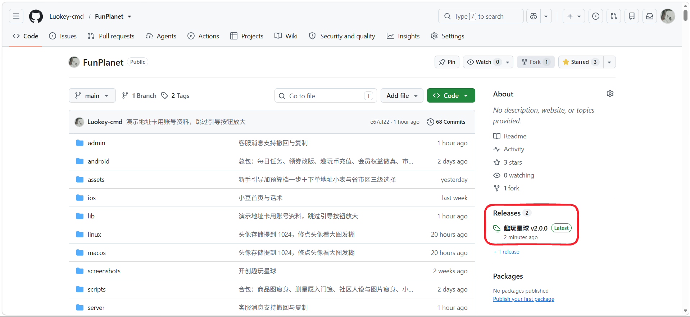

#### 步骤 2 · 下载 APK

拉到 Release 页面底部的 **Assets** 区域，点击 **`FunPlanet-v2.0.0.apk`** 开始下载（约 130 MB，以页面标注为准；这一版把商品图统一瘦身过，比早期版本明显小一圈）。下方两个 Source code 是 GitHub 自动附带的源码包，是给看代码的人准备的——**体验 App 只需下载 APK 这一个文件**。

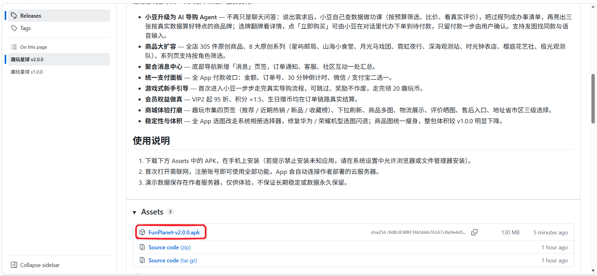

#### 步骤 3 · 发送到手机（微信文件传输助手）

把安装包从电脑挪到手机，最顺手的是微信：在电脑上打开 **微信 → 文件传输助手**，将下载好的 `FunPlanet-v2.0.0.apk` 拖入对话框发送，手机微信里立刻就能收到。

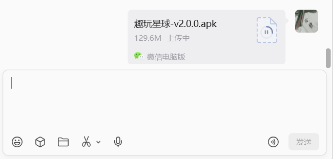

#### 步骤 4 · 在手机上保存文件

在手机微信里点开刚收到的文件，在弹出菜单中选择 **「保存」**，先把 APK 存到本机存储里——下一步安装时要从文件管理器里找它。

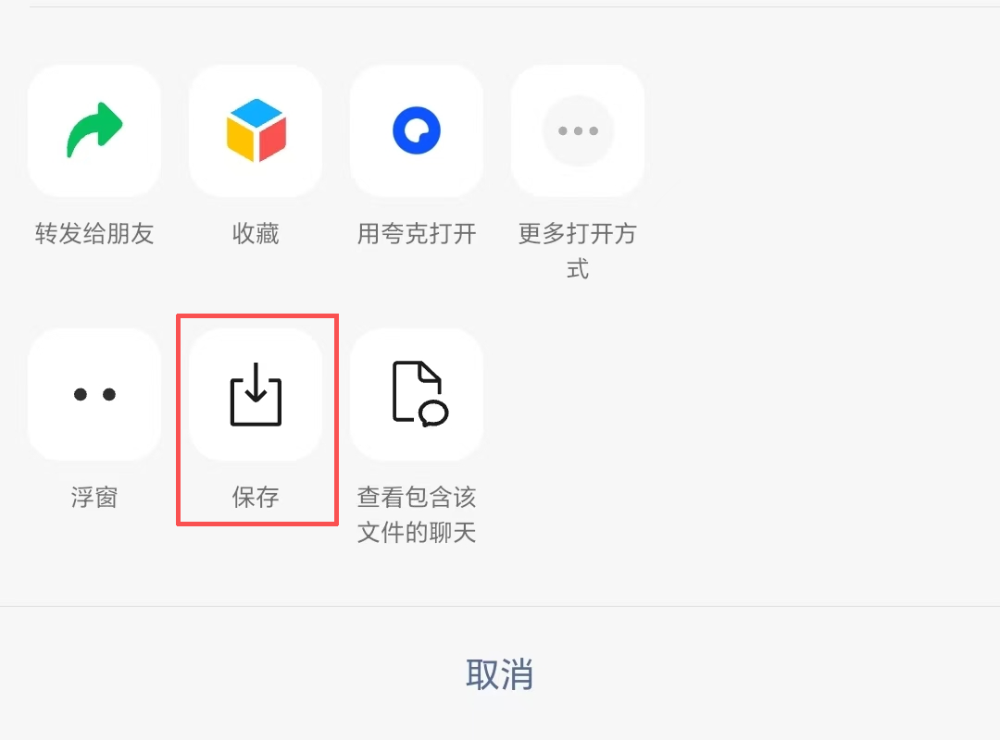

#### 步骤 5 · 在文件管理器中安装

打开手机的 **文件管理器 → 最近**，找到 `FunPlanet-v2.0.0.apk`（来源可能显示为「微信」），点它开始安装；装好后桌面上就会多出一个趣玩星球的图标。

- 若文件名带有 **`.apk.1`** 后缀，请先 **重命名** 为 `FunPlanet-v2.0.0.apk` 再安装
- 若提示「禁止安装未知应用」，请在系统设置中允许 **文件管理器** 或 **微信** 安装未知来源应用

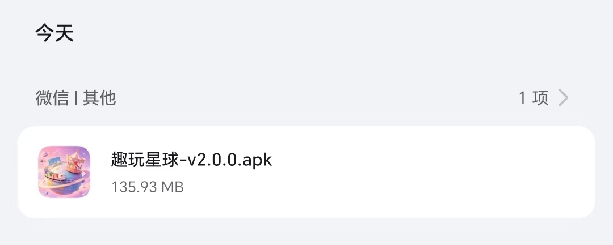

---

### 二、注册账号

#### 步骤 6 · 创建账号

首次打开 App 需 **联网**（登录、小豆、绘画这些功能都连着云端服务器）。点击 **注册**，填写昵称、手机号、密码（至少 6 位），勾选用户协议后完成注册。注册成功会直接落到首页，别急着逛——先去把新人优惠券领了，后面下单能直接抵钱。

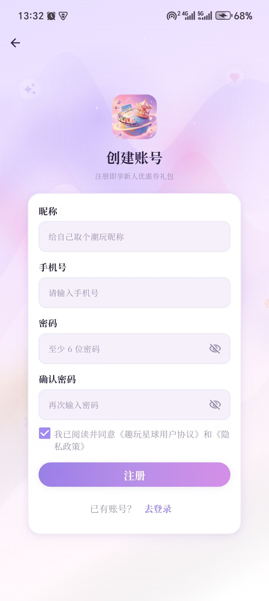

---

### 三、体验 App 功能

安装并登录后，App 会自动连接打包时配置的线上 API（真实服务器地址出于安全不在文档中公开，配置方法见 `lib/config/production_api_host.dart`），以下功能均可在线体验。下面就按第一次打开 App 的顺序，带你把趣玩星球逛一遍：先逛商城的五个页面，再让小豆替你挑一件东西，最后去 AI 绘画和社区转转。

#### 步骤 7 · 页面浏览

底部五个 Tab 是 App 的主干：**首页 / 商城 / 消息 / 购物车 / 我的**，五个页面都在这里一次看全。

- **首页** — App 的门面：分类入口、活动 Banner、每日任务、领券中心与会员专享福利都在这一页，右下角还有小豆探着头等你点它；下方「趣玩市集」分 **推荐 / 近期热销 / 新品 / 收藏榜** 四个页签，下拉刷新就换一批新面孔。
- **商城** — 全部 305 件商品的大货架：可按 7 大类筛选，也能按系列、角色与品类搜索；点任意系列的横幅还能进系列页，按角色一位位慢慢挑。
- **消息** — 以前要到处找的提醒都收到了这里：订单到哪了看交易通知，有问题点客服中心，社区里谁赞了你、回了你也在这页；有未读时，底部导航的「消息」上会挂一个小角标。
- **购物车** — 心动过的商品先在这里集合：调整数量、勾选要买的，合计金额实时算给你看；点去结算就进入下单，付款时会弹出全 App 统一的支付面板（金额、订单号、30 分钟倒计时、微信 / 支付宝二选一）。
- **我的** — 你的个人小仓库：积分、趣玩币、优惠券与 VIP 会员权益一目了然；订单按 **待付款 / 待发货 / 待收货 / 待评价 / 售后退款** 分区排好，点进去能看物流、评价晒图、申请售后；「我的内容」收着你的社区动态、AI 绘画、盒柜收藏（按系列点亮集齐进度）与评价；个人资料可编辑（头像支持点开看大图），新手引导跳过了也能从这里重进。

下图第一行从左到右是首页、商城、消息，第二行是购物车、我的：

<table>
<tr>
<td width="33%">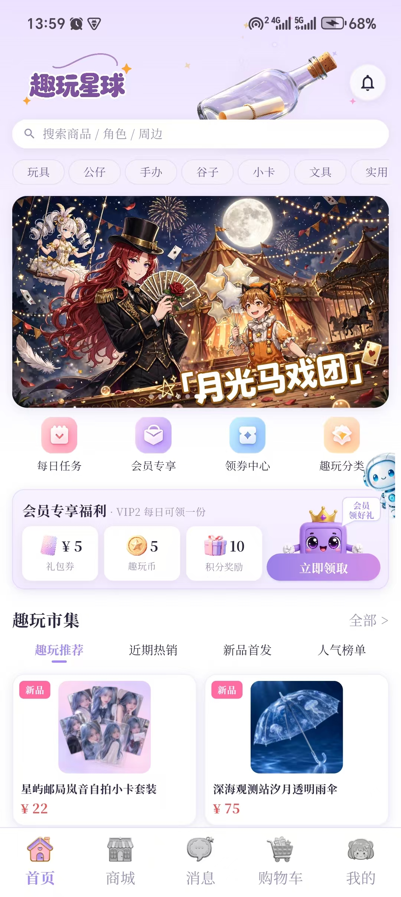</td>
<td width="33%">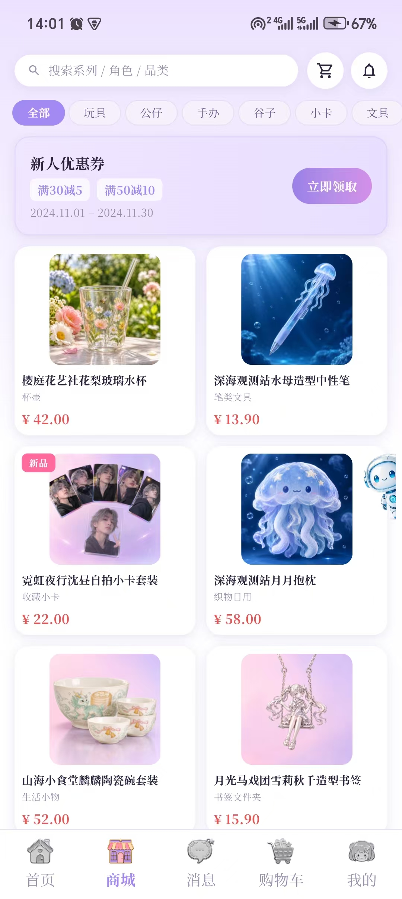</td>
<td width="33%">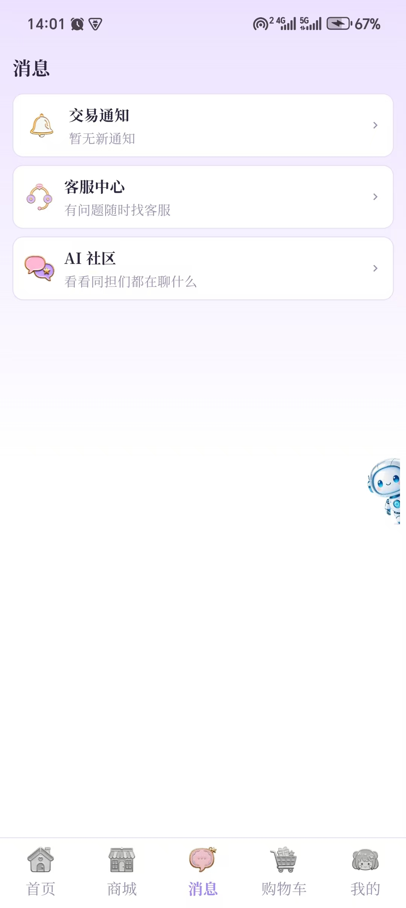</td>
</tr>
<tr>
<td width="33%">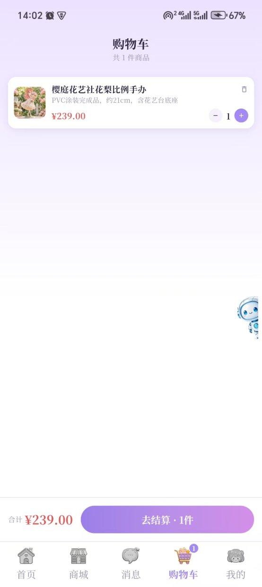</td>
<td width="33%">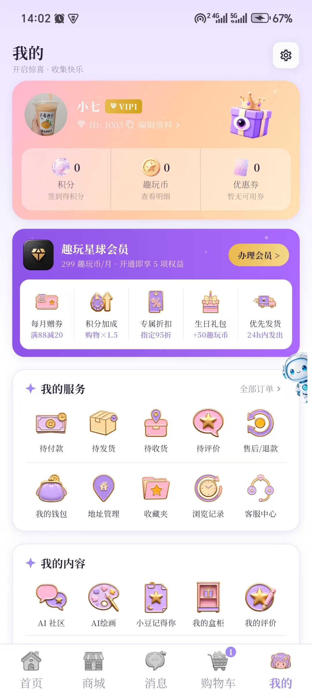</td>
<td width="33%"></td>
</tr>
</table>

#### 步骤 8 · 商品详情

在首页或商城点任意一件商品，就进入它的 **商品详情** 页：大图可以左右滑着看细节，现价、原价与折扣标得清清楚楚，下面还有「小豆点评」一句话说清它适合谁、适合送谁。页面里能收藏、分享，也能直接 **加入购物车 / 立即购买**，拿不准就点联系客服问一句；如果这件属于某个系列，页面下方还有该系列的图鉴入口，可以顺路把同系列的其他款一起看完。下单后可在订单里追物流，收货后能评价晒图、不满意可申请售后。

商品页还可查看真实用户评价与详细参数（规格、材质、比例、包装等）。下图左为商品详情、右为评价与参数：

<table>
<tr>
<td width="50%"></td>
<td width="50%">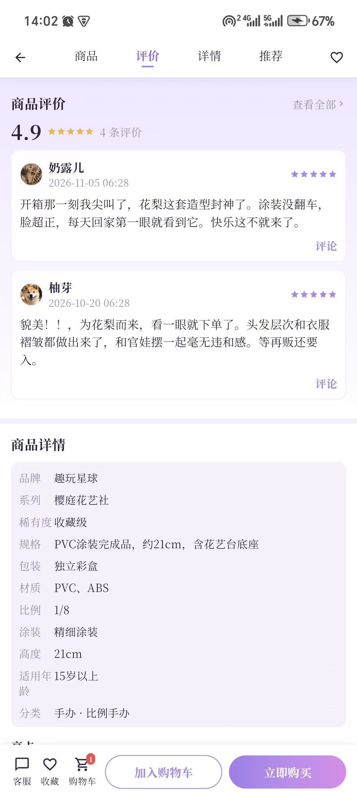</td>
</tr>
</table>

#### 步骤 9 · 小豆 AI 导购（Agent 选品）

小豆就住在首页，点它或进入 **小豆** 聊天页，说出想买什么（例如「挑手办」）。小豆会先问一两个问题，然后在后台做功课（按预算筛选、比价、看真实评价），把过程列成办事清单，再亮出 **三张商品牌**，每张牌头上写着它的长处（口碑最好 / 收藏最多 / 折扣最大等，都由真实数据同批比对算出）；点牌面上方的预算档（如「¥100内」）可按预算重选，点中一张会整屏翻牌落成详细卡。点详细卡的 **立即购买**，小豆直接在对话里代办下单（整理优惠券、收货地址），只留最后付款一步给用户确认。也支持发图片找同款、语音输入（识别文字先落输入框，确认后再发）；活动、优惠、会员这类问题也可以直接问它，涉及店内商品与价格时只依据查到的真实数据作答。

首次进入小豆时有**游戏式新手引导**：跟着发光的手指把上面这套流程完整走一遍（演示单不会真下单），走完领 20 趣玩币；跳过不作废奖励，之后可从「我的」页重进。下图七张就是这套流程的完整截图：首页的小豆、点「挑手办」、亮牌、翻牌、翻开后的详细卡、小豆代办整理、演示完成领奖励。

<table>
<tr>
<td width="33%">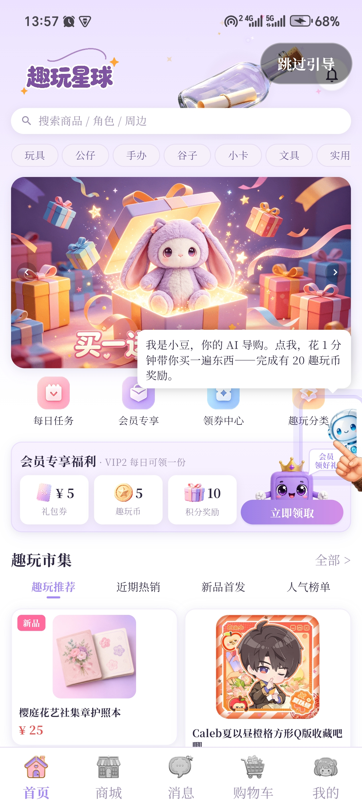</td>
<td width="33%">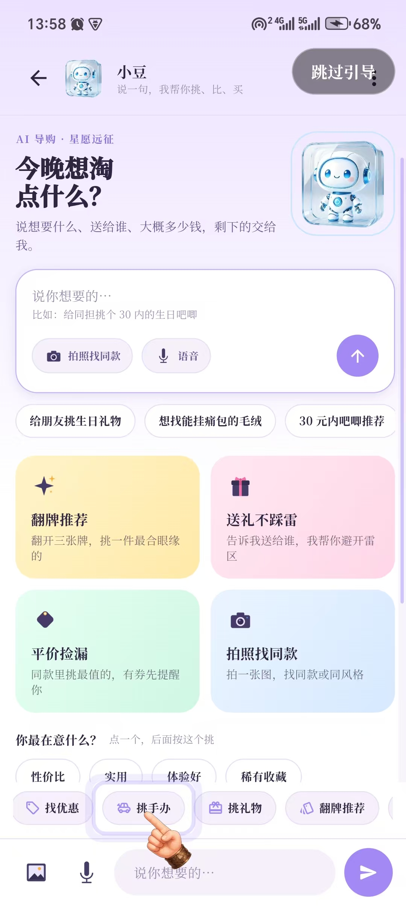</td>
<td width="33%">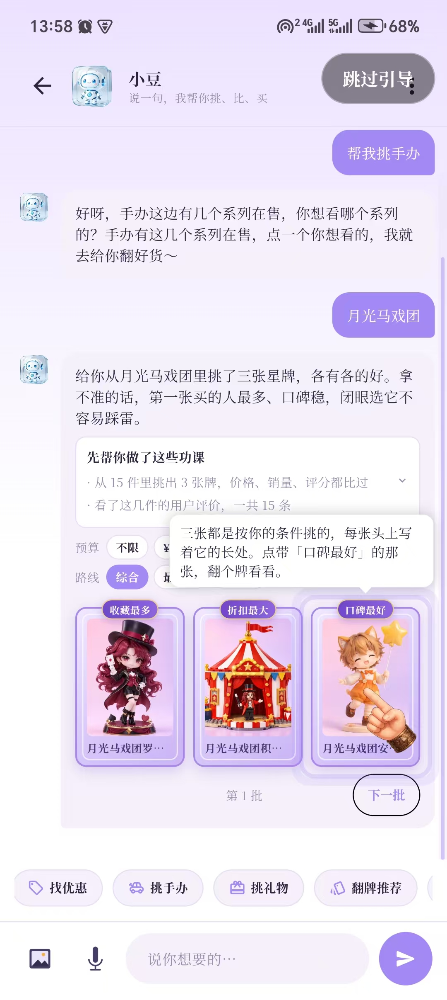</td>
</tr>
<tr>
<td width="33%"></td>
<td width="33%">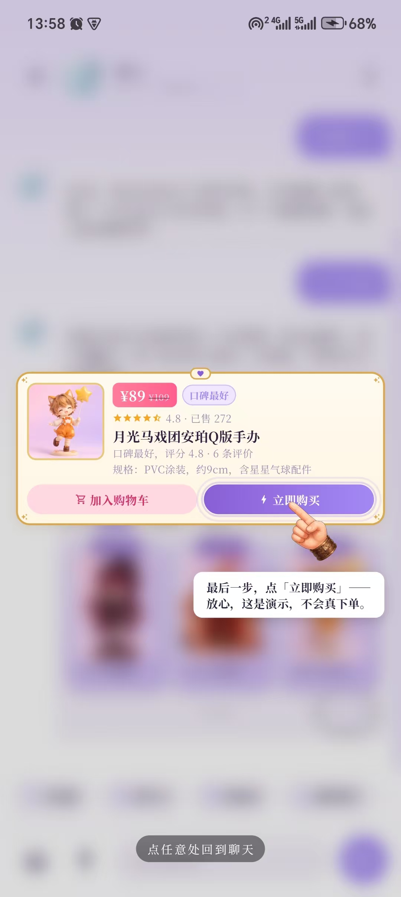</td>
<td width="33%">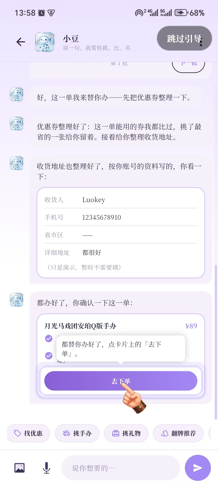</td>
</tr>
<tr>
<td width="33%">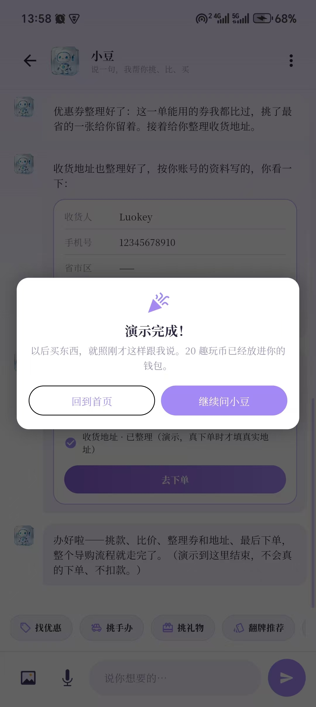</td>
<td width="33%"></td>
<td width="33%"></td>
</tr>
</table>

#### 步骤 10 · AI 绘画

想自己动手创作就来这页：先选一种绘画风格（不同风格出图差异明显，同一句话能画出完全不同的味道），再写一句描述——比如「穿星空裙的少女站在月光马戏团门口」——点 **开始创作**（每次生成一张），稍等片刻，一张专属于你的图就出来了。满意就 **保存到本地**，不满意可以换个说法再生成；所有作品都同步存在云端，「我的作品」里可以多选批量保存到相册、也可以批量删除。


#### 步骤 11 · AI 社区

这里是一个热闹的小朋友圈：信息流里是所有用户和 8 位 AI 好友的动态，可以点赞、评论，也可以点 **发动态** 发自己的图文帖子。8 位 AI 虚拟朋友性格各不相同，会自己发动态，也会跑到你的帖子下面点赞评论（自动回复由 DeepSeek 驱动）——发一条试试，看谁先来捧场。


---

## 主要功能

**商城购物**
- **首页 / 商城** — 商品浏览、7 大类分类、搜索、Banner 轮播、每日任务与签到
- **趣玩市集** — 推荐（新品优先的综合排序）/ 近期热销 / 新品 / 收藏榜四页签，下拉刷新换一批
- **原创商品** — 305 件、8 大原创系列（星屿邮局、山海小食堂、月光马戏团、霓虹夜行、深海观测站、时光钟表店、樱庭花艺社、极光观测队），系列页可按角色筛选商品
- **购物车 / 订单** — 加购、结算、优惠券、会员折扣、物流展示、评价晒图、售后入口、统一支付面板

**小豆 AI 导购**
- **Agent 办事** — 需求理解、功课清单、亮三张牌、翻牌详情、对话内代买到待付款，付款才由用户确认
- **多模态** — 发图找同款（视觉模型）、语音输入（系统识别，失败自动转云端 ASR）
- **记忆** — 记住用户的偏好与历史对话要点（「小豆记得你」），答疑只用真实数据、正经问题给干货结论

**AI 创作与社区**
- **AI 绘画** — 文生图，多风格，作品云端保存、可存本地
- **AI 社区** — 发图文动态、点赞评论，8 位 AI 好友自动互动（DeepSeek 驱动）

**会员与个人中心**
- **会员体系** — VIP 等级、积分、趣玩币、每月赠券；95 折、积分 ×1.5、生日币真实结算
- **我的** — 订单五态、地址管理（省市区三级选择）、收藏与盒柜、浏览记录、我的评价、编辑资料
- **消息中心** — 通知、客服会话、社区互动聚合

**在线客服** — 实时聊天，支持图片与表情消息；用户与客服均可撤回自己刚发的消息（2 分钟内）并复制文字消息，后台客服中心统一回复

---

## 管理后台

项目包含 **React 管理后台**（`admin/`），供运营人员在浏览器端管理 App 数据。需本地或服务器启动后端与后台服务后访问（开发环境默认如 `http://localhost:5173`）。

- **数据看板** — 总营收、订单数、注册用户、商品总数及趋势图表，统计卡可点击直达对应管理页
- **营收分析** — 付费订单与分类营收统计
- **商品管理** — 商品增删改、图片上传、价格库存
- **订单管理** — 订单筛选、发货、确认送达
- **用户管理** — 注册用户查看与管理
- **营销中心 / 财务账单** — 活动与券管理、账单流水
- **优惠券 / 轮播图** — 营销活动与首页 Banner 配置
- **客服中心** — 在线回复 App 用户咨询
- **更新日志 / 系统设置** — 版本说明与后台配置

### 数据看板

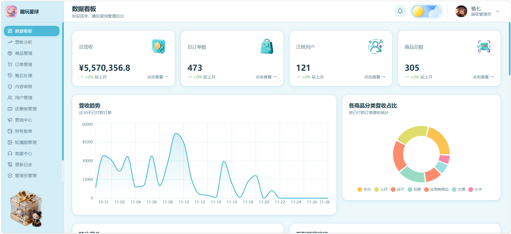

### 订单管理

App 端下单后，订单会同步至管理后台，可进行发货与状态管理。

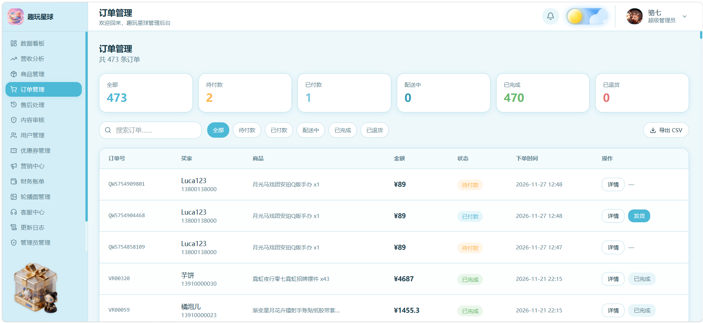

### 用户管理

注册用户一览，可按账号、状态与注册时间查询，查看每位用户的 VIP 等级、积分、趣玩币、订单数与累计消费。

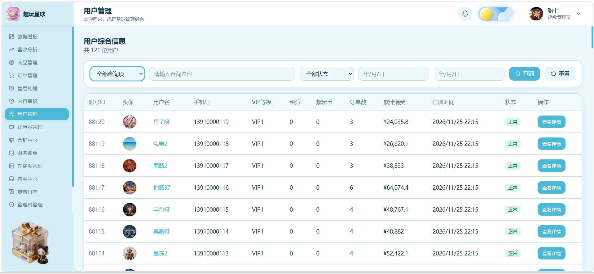

---

## 云服务器与数据

Release APK **已关联作者部署的云服务器**，以下数据会同步至云端：

- 账号（注册 / 登录）
- 购物车、订单、地址、收藏、优惠券、个人资料
- 用户头像、评价图片、AI 社区图片、客服聊天图片
- AI 绘画生成结果

演示数据保存在作者服务器，与 GitHub 源码仓库无关，仅供开源体验，不保证长期稳定或数据永久保留。

---

## AI 模型

| 功能 | 模型 | 服务 |
|------|------|------|
| AI 导购（小豆 Agent：工具调用 + 联网搜索 + 思考） | **通义千问旗舰模型**（保底降级 qwen-plus） | [阿里云百炼 DashScope](https://dashscope.aliyuncs.com) |
| AI 看图（发图找同款） | **通义视觉模型 qwen-vl 系列** | 阿里云百炼 DashScope |
| 语音识别（云端后备） | **qwen3-asr-flash** | 阿里云百炼 DashScope |
| AI 生图 | **通义万相 `wan2.6-t2i`** | 阿里云百炼 DashScope |
| AI 社区自动回复 | **DeepSeek `deepseek-chat`** | [DeepSeek API](https://api.deepseek.com) |

AI 能力由服务端统一调用，App 内不包含 API Key。

---

## 技术栈

| 模块 | 技术 |
|------|------|
| 移动端 | Flutter, Dart, Provider, http, image_picker |
| 后端 | Node.js, Express, Prisma, PostgreSQL, JWT |
| 管理后台 | React, Vite, TypeScript |
| 部署 | 云服务器（ECS + nginx + systemd）, Docker Compose（本地） |
| AI | 阿里云百炼（通义千问 / 万相 / 语音 / 视觉）, DeepSeek API |

---

## 项目结构

```
funplanet/
├── lib/              # Flutter 客户端源码
├── android/          # Android 工程
├── assets/           # 静态资源（商品图、Banner、省市区数据等）
├── server/           # Node.js API + Prisma 数据库
├── admin/            # React 管理后台
├── scripts/          # 打包、部署、真机调试脚本
├── docker-compose.yml
├── 产品需求.md        # PRD：功能口径以此为准
├── 软件框架.md        # 架构说明
├── 当前进度.md        # 进度与变更记录（随每次代码变更同步更新）
└── 开源说明-未上传GitHub的文件.txt
```

---

## 本地开发

### 环境要求

- Flutter SDK（Dart ^3.12）
- Node.js 18+
- PostgreSQL（或 Docker）

### 1. 后端

```bash
cp .env.example .env
# 编辑 .env，填写 DATABASE_URL、JWT_SECRET、各 AI 模型的 API Key 等

cd server
npm install
npx prisma db push   # 按当前结构建表（新库请用 db push，不要用 migrate deploy）
npm run db:seed      # 灌入演示数据（305 件商品等）
npm run dev
```

API 默认运行在 `http://127.0.0.1:3000`（可用 `.env` 的 `PORT` 修改，作者本地使用 3200）。

### 2. Flutter App

```bash
flutter pub get
flutter run
```

Debug 模式下 App 会自动尝试连接本机 / 模拟器后端（见 `lib/config/api_config.dart`）。真机调试推荐走局域网直连：把电脑的局域网 IP 手动写入 `lib/config/local_api_host.dart` 的预留位置即可（该文件填入 IP 后不要提交，仓库中保持为空）。

### 3. 管理后台（可选）

```bash
cp admin/.env.example admin/.env
cd admin
npm install
npm run dev
```

### 4. Docker 一键部署（生产）

```bash
cp .env.production.example .env
# 填写 POSTGRES_PASSWORD、JWT_SECRET 等
docker compose up -d --build
```

---

## 打包 Release APK

```bash
flutter build apk --release --dart-define=API_BASE_URL=http://你的服务器:3000
```

产物路径：`build/app/outputs/flutter-apk/app-release.apk`

线上 API 地址也可配置在 `lib/config/production_api_host.dart`。商品图已统一转 JPG 瘦身，新版整包体积较 v1.0.0 明显下降。

---

## 开源说明

仓库中 **故意未包含** 部分文件（如 `.env`、密钥、`node_modules`、构建产物等），详见：

**[开源说明-未上传GitHub的文件.txt](./开源说明-未上传GitHub的文件.txt)**

克隆后若缺少上述文件，属预期行为，并非仓库不完整。

---

## 相关链接

- **Release 安装包**：https://github.com/Luokey-cmd/FunPlanet/releases
- **问题反馈**：https://github.com/Luokey-cmd/FunPlanet/issues

---

## License

暂未指定开源协议。如需参加竞赛或商用，请先通过 Issues 联系作者huanghengxin_2004@qq.com。
